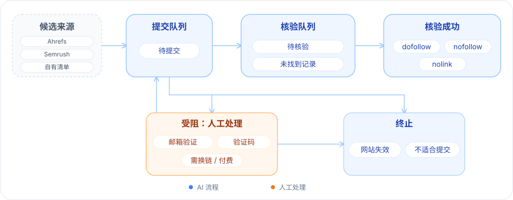

# Backlink Submitter

**把外链提交的重复工作交给 AI。**

提供产品资料和候选网站，AI 帮你筛选免费渠道、逐站填表提交，再确认链接是否生效。

- **少填重复表单**：复用产品介绍、账号和素材，减少重复填写和上传。
- **进度随时可查**：提交结果、公开页和下一步统一记录在飞书 Base。
- **需要你时再接手**：遇到登录或验证码，保留页面并告诉你要做什么。

## 从候选，到有效外链



## 一张表管理所有外链提交

哪些网站值得投、费用多少、提交后有没有外链，一张表看清。
以下为虚构示例，流量为估算月访问量（千次），ROI 为筛选参考分，date 为归档日期。

| 网站 | DR | 流&#8288;量&nbsp;(k) | 费用($) | ROI | 状态 | 公开页 | 备注 | date |
| --- | ---: | ---: | ---: | ---: | --- | --- | --- | --- |
| 示例 A | 56 | 120 | 0 | 63.3 | 待核验 | — | 已提交，等待审核 | 2026-10-20 |
| 示例 B | 67 | 350 | 0 | 83.4 | 已验证：dofollow | directory.example/product | 公开页已包含官网链接 | 2026-10-18 |
| 示例 C | 42 | 28.5 | 0 | 27.2 | 受阻：人工处理 | — | 等你完成验证码后继续 | 2026-10-21 |
| 示例 D | 52 | 86 | 0 | 54.6 | 已验证：nofollow | listing.example/product | 官网链接已上线，属性为 nofollow | 2026-10-16 |
| 示例 E | 71 | 480 | 49 | 1.7 | 受阻：需换链/付费 | — | 仅提供 $49 付费入口，未提交、未付款 | 2026-10-22 |

## Getting Started

复制下面的话，发给 AI agent：

```text
请用这个工具帮我提交、核验和跟进外链：
https://github.com/wzhang35/backlink-submitter

先阅读仓库中的 AGENTS.md，按指引完成接入并开始处理。缺少资料或需要我配合时，直接告诉我。
```

需要支持本地文件、终端和 Chrome 操作的 agent，以及飞书账号。已有产品资料或飞书 Base 可以一并提供。Agent 会按 [接入指南](AGENTS.md) 完成准备。

[Base 字段标准](.agents/skills/backlink-submitter/references/base-setup.md) · [维护与发布](docs/maintaining.md) · [MIT License](LICENSE)
